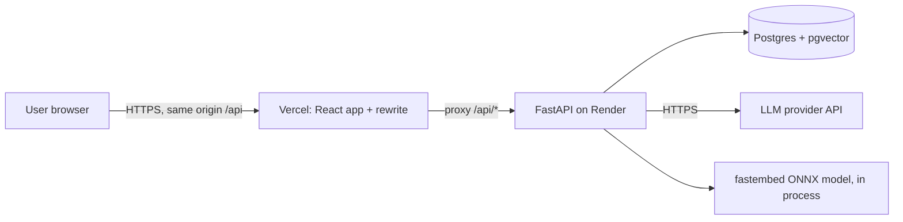
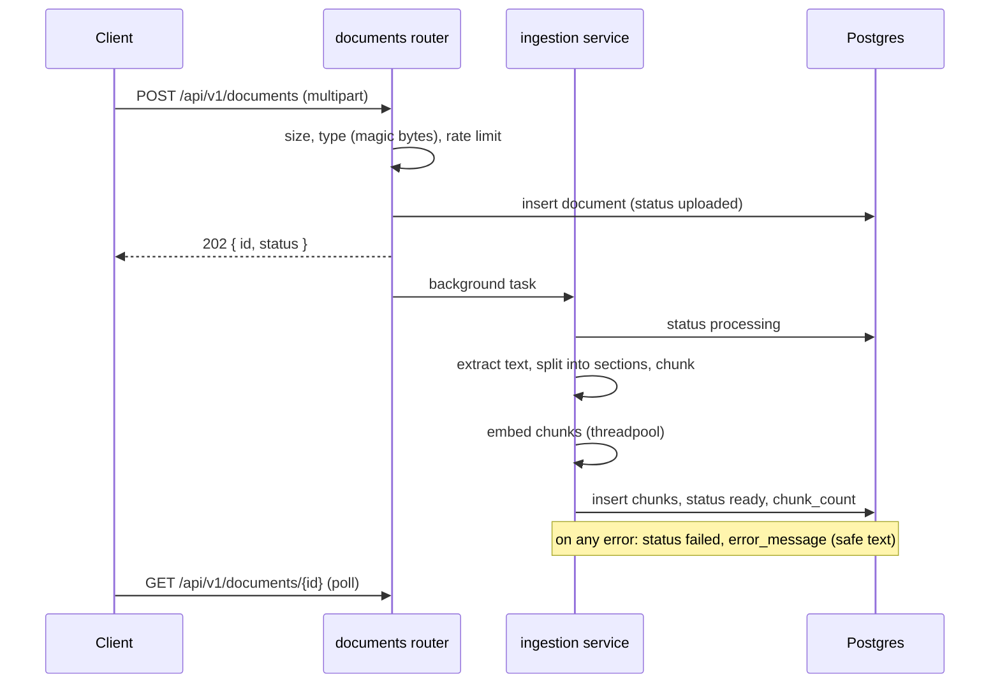
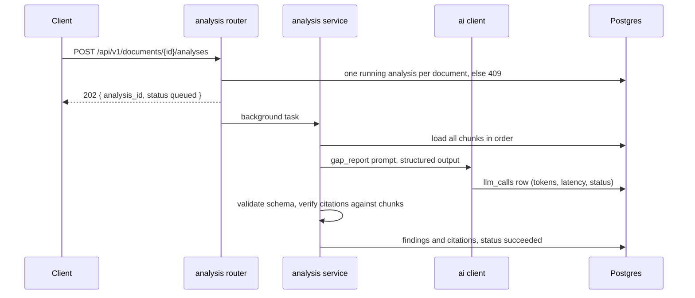
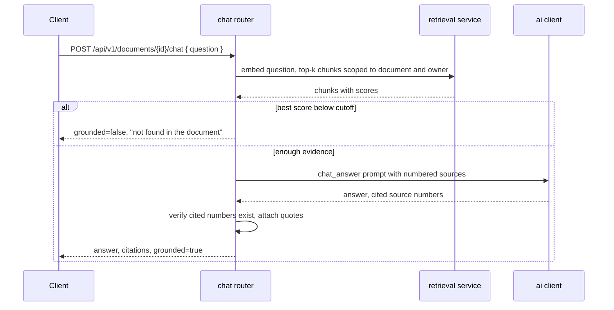

# Architecture

## Context



One backend, one database, one embedding model running inside the backend process. No queue, no cache, no separate vector store. Add these only when a measured problem requires them.

## Modules

| Module | Responsibility |
|---|---|
| `auth` | Register, login, refresh rotation, logout, current user, password hashing, token issue and verification |
| `documents` | Upload endpoint, document CRUD, status state machine, ownership checks |
| `ingestion` | Validate file, extract text and sections, chunk, embed, store. Runs as a background task |
| `retrieval` | Embed a question, run the scoped similarity query, apply the score cutoff |
| `analysis` | Build the gap report: prompt, structured output, citation verification, persistence |
| `chat` | Threads and messages, grounded answers using `retrieval` |
| `ai` | The only place that talks to the LLM: client wrapper, prompt files, output schemas, call logging |
| `core` | Config, logging, error types, request id, security helpers, rate limiting |
| `db` | Engine, session, base model, Alembic environment |

Dependency direction: `api -> modules (service) -> modules (repository) -> db`. `analysis` and `chat` may use `ai` and `retrieval`. `ai` depends on nothing else in the app except `core`. Modules never import each other's repositories; they call the other module's service.

## Folder structure

```
gaplens/
  AGENTS.md  CLAUDE.md  README.md  Makefile  docker-compose.yml  .env.example
  .claude/settings.json  .cursor/rules/gaplens.mdc  .github/
  docs/
  infra/db/init/
  backend/
    pyproject.toml  Dockerfile  alembic.ini
    alembic/versions/
    app/
      main.py                    app factory, middleware, routers
      core/
        config.py  logging.py  errors.py  security.py  rate_limit.py  request_id.py
      db/
        session.py  base.py
      api/
        router.py  health.py  deps.py
      modules/
        auth/        router.py  service.py  repository.py  schemas.py  models.py
        documents/   router.py  service.py  repository.py  schemas.py  models.py
        ingestion/   extract.py  chunker.py  embedder.py  service.py
        retrieval/   service.py  repository.py
        analysis/    router.py  service.py  repository.py  schemas.py  models.py  citations.py
        chat/        router.py  service.py  repository.py  schemas.py  models.py
      ai/
        client.py  schemas.py  calls.py
        prompts/     gap_report.v1.md  chat_answer.v1.md
    tests/
      fakes/  unit/  api/  db/
  frontend/
    src/  app/  pages/  features/  components/ui/  lib/  styles/
  evals/
    datasets/  golden/  run.py  results/ (gitignored)
```

Files inside a module:
- `router.py`: FastAPI routes, request parsing, response models. No logic.
- `service.py`: business rules, orchestration, transactions.
- `repository.py`: SQL only. Every method that touches user data takes `owner_id`.
- `schemas.py`: Pydantic request and response models.
- `models.py`: SQLAlchemy models.

## Flows

### Upload and ingestion



Document status machine: `uploaded -> processing -> ready` or `failed`. A document can be re-processed only from `failed`. Original files are discarded after extraction (ADR-006).

### Gap report



Gap detection reads the whole document in one call (ADR-007). Retrieval is the wrong tool for finding absence.

### Chat answer



## Cross-cutting rules

Errors. One exception handler converts domain errors to the problem format in `docs/api.md`. Unhandled exceptions return a generic 500 with the request id; details go to logs.

Request id. Middleware sets `X-Request-ID` (accepts a valid incoming one, otherwise generates one), stores it in a context variable, and the logging filter adds it to every log line.

Logging. Structured, one line per event, level from config. Never log secrets, tokens, document text, prompts or model outputs (see `docs/security.md`).

Background work. FastAPI `BackgroundTasks` for the first version. Each task opens its own database session, writes its own status, and catches all exceptions so a document or analysis never stays in `processing` forever. A startup sweep marks any row stuck in `processing` for more than 15 minutes as `failed`. Upgrade path if needed: a worker process with a Postgres-backed job table.

Configuration. `pydantic-settings` reads environment variables; `.env` only for local use. Production secrets are set in the host dashboard.

Time. Store `timestamptz` in UTC. The frontend formats in the user's locale.

IDs. UUID primary keys generated by the database (`gen_random_uuid()`).

Pagination. Keyset (cursor) pagination on list endpoints. Cursor is an opaque base64 string of `(created_at, id)`.

## Environments

| Environment | Database | API | Frontend |
|---|---|---|---|
| local | Compose `db` service | Compose `api` or local uvicorn | Vite dev server with `/api` proxy |
| test | Postgres with pgvector in CI or Compose | pytest with httpx | Vitest |
| production | Managed Postgres with pgvector | Render or Railway | Vercel with `/api` rewrite |
