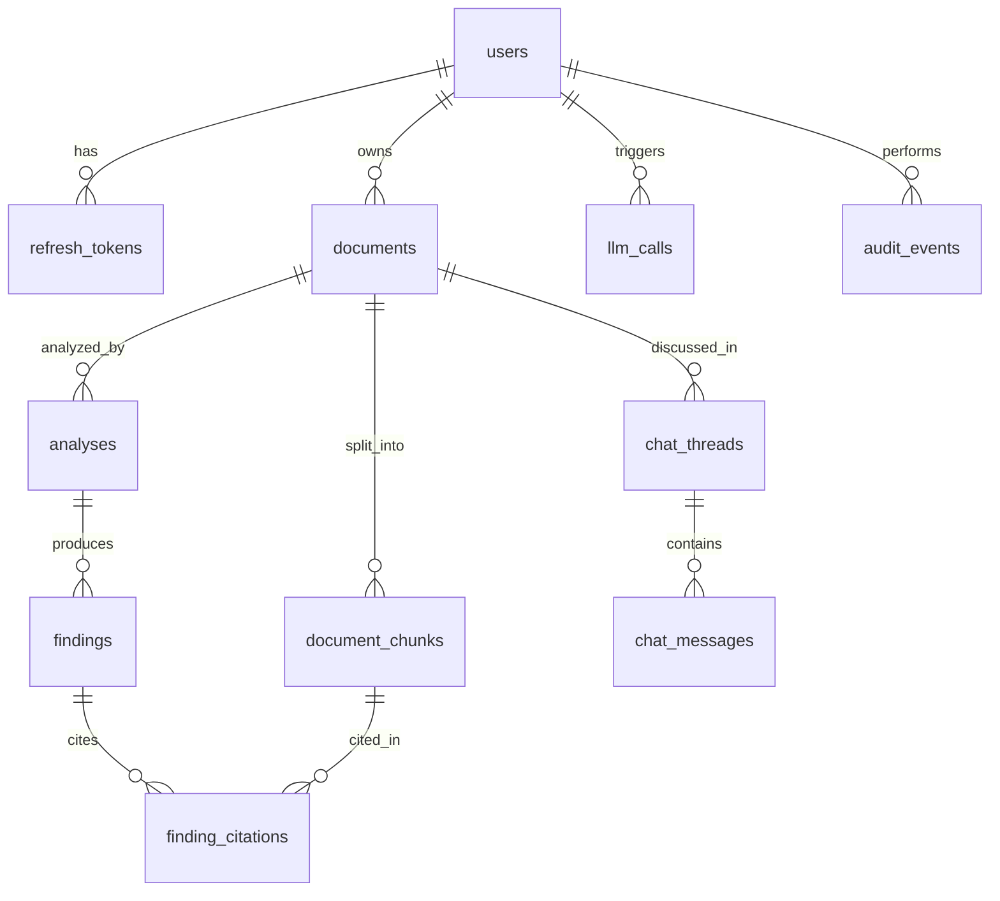

# Database

PostgreSQL 16 with the `pgvector` extension. All timestamps are `timestamptz`. All primary keys are `uuid DEFAULT gen_random_uuid()` unless stated. Naming: plural snake_case tables, `<table_singular>_id` foreign keys, indexes named `<table>_<columns>_idx`, unique indexes `<table>_<columns>_uidx`.

Schema changes go through Alembic only. The DDL below is the target after Sprint 3; each sprint adds its tables (see `docs/sprints.md`). The ORM models and the migrations must match this file; if you change one, change the others and this file in the same commit.

## Entity overview



## DDL

```sql
CREATE EXTENSION IF NOT EXISTS vector;

-- Sprint 1 -----------------------------------------------------------------

CREATE TABLE users (
  id            uuid PRIMARY KEY DEFAULT gen_random_uuid(),
  email         text        NOT NULL CHECK (length(email) <= 254),
  password_hash text        NOT NULL,
  role          text        NOT NULL DEFAULT 'user' CHECK (role IN ('user', 'admin')),
  is_active     boolean     NOT NULL DEFAULT true,
  created_at    timestamptz NOT NULL DEFAULT now(),
  updated_at    timestamptz NOT NULL DEFAULT now(),
  last_login_at timestamptz
);
CREATE UNIQUE INDEX users_email_lower_uidx ON users (lower(email));

CREATE TABLE refresh_tokens (
  id          uuid PRIMARY KEY DEFAULT gen_random_uuid(),
  user_id     uuid        NOT NULL REFERENCES users(id) ON DELETE CASCADE,
  family_id   uuid        NOT NULL,
  token_hash  text        NOT NULL,          -- sha256 hex of the opaque token
  expires_at  timestamptz NOT NULL,
  revoked_at  timestamptz,
  replaced_by uuid REFERENCES refresh_tokens(id) ON DELETE SET NULL,
  created_at  timestamptz NOT NULL DEFAULT now(),
  user_agent  text,
  ip          inet
);
CREATE UNIQUE INDEX refresh_tokens_token_hash_uidx ON refresh_tokens (token_hash);
CREATE INDEX refresh_tokens_user_id_idx   ON refresh_tokens (user_id);
CREATE INDEX refresh_tokens_family_id_idx ON refresh_tokens (family_id);
CREATE INDEX refresh_tokens_expires_at_idx ON refresh_tokens (expires_at);  -- cleanup job

-- Sprint 2 -----------------------------------------------------------------

CREATE TABLE documents (
  id              uuid PRIMARY KEY DEFAULT gen_random_uuid(),
  owner_id        uuid        NOT NULL REFERENCES users(id) ON DELETE CASCADE,
  title           text        NOT NULL CHECK (length(title) BETWEEN 1 AND 200),
  filename        text        NOT NULL CHECK (length(filename) <= 255),
  mime_type       text        NOT NULL,
  size_bytes      integer     NOT NULL CHECK (size_bytes > 0),
  sha256          char(64)    NOT NULL,
  status          text        NOT NULL DEFAULT 'uploaded'
                  CHECK (status IN ('uploaded', 'processing', 'ready', 'failed')),
  error_message   text,
  page_count      integer,
  chunk_count     integer     NOT NULL DEFAULT 0,
  embedding_model text,
  created_at      timestamptz NOT NULL DEFAULT now(),
  updated_at      timestamptz NOT NULL DEFAULT now(),
  deleted_at      timestamptz
);
-- Same file uploaded twice by one user is rejected, unless the earlier one was deleted.
CREATE UNIQUE INDEX documents_owner_sha256_uidx
  ON documents (owner_id, sha256) WHERE deleted_at IS NULL;
-- Serves the document list (keyset pagination).
CREATE INDEX documents_owner_created_idx
  ON documents (owner_id, created_at DESC, id DESC) WHERE deleted_at IS NULL;

CREATE TABLE document_chunks (
  id            uuid PRIMARY KEY DEFAULT gen_random_uuid(),
  document_id   uuid        NOT NULL REFERENCES documents(id) ON DELETE CASCADE,
  owner_id      uuid        NOT NULL REFERENCES users(id) ON DELETE CASCADE,  -- denormalized on purpose
  chunk_index   integer     NOT NULL CHECK (chunk_index >= 0),
  section_label text,                      -- for example "3.1"
  heading       text,
  content       text        NOT NULL,
  token_count   integer     NOT NULL CHECK (token_count > 0),
  page_start    integer,
  embedding     vector(384) NOT NULL,
  created_at    timestamptz NOT NULL DEFAULT now()
);
CREATE UNIQUE INDEX document_chunks_doc_index_uidx ON document_chunks (document_id, chunk_index);
-- Retrieval always filters by document_id first (see "Retrieval query").
-- No vector index in v1: exact search over a few hundred rows is fast and has perfect recall.

-- Sprint 3 -----------------------------------------------------------------

CREATE TABLE analyses (
  id             uuid PRIMARY KEY DEFAULT gen_random_uuid(),
  document_id    uuid        NOT NULL REFERENCES documents(id) ON DELETE CASCADE,
  owner_id       uuid        NOT NULL REFERENCES users(id) ON DELETE CASCADE,
  status         text        NOT NULL DEFAULT 'queued'
                 CHECK (status IN ('queued', 'running', 'succeeded', 'failed')),
  prompt_version text        NOT NULL,
  model          text        NOT NULL,
  summary        text,
  findings_count integer     NOT NULL DEFAULT 0,
  error_message  text,
  created_at     timestamptz NOT NULL DEFAULT now(),
  completed_at   timestamptz
);
CREATE INDEX analyses_document_created_idx ON analyses (document_id, created_at DESC);
-- At most one active analysis per document (idempotent start, no double spend).
CREATE UNIQUE INDEX analyses_one_active_per_document_uidx
  ON analyses (document_id) WHERE status IN ('queued', 'running');

CREATE TABLE findings (
  id                 uuid PRIMARY KEY DEFAULT gen_random_uuid(),
  analysis_id        uuid        NOT NULL REFERENCES analyses(id) ON DELETE CASCADE,
  position           integer     NOT NULL,            -- display order
  kind               text        NOT NULL CHECK (kind IN ('missing', 'unclear', 'contradiction')),
  severity           text        NOT NULL CHECK (severity IN ('high', 'medium', 'low')),
  title              text        NOT NULL CHECK (length(title) <= 160),
  description        text        NOT NULL,
  suggested_question text        NOT NULL,
  review_status      text        NOT NULL DEFAULT 'open'
                     CHECK (review_status IN ('open', 'confirmed', 'dismissed')),
  created_at         timestamptz NOT NULL DEFAULT now(),
  updated_at         timestamptz NOT NULL DEFAULT now()
);
CREATE UNIQUE INDEX findings_analysis_position_uidx ON findings (analysis_id, position);

CREATE TABLE finding_citations (
  id            uuid PRIMARY KEY DEFAULT gen_random_uuid(),
  finding_id    uuid NOT NULL REFERENCES findings(id) ON DELETE CASCADE,
  chunk_id      uuid NOT NULL REFERENCES document_chunks(id) ON DELETE CASCADE,
  section_label text,
  quote         text NOT NULL                      -- verified verbatim substring of the chunk
);
CREATE INDEX finding_citations_finding_id_idx ON finding_citations (finding_id);
CREATE INDEX finding_citations_chunk_id_idx   ON finding_citations (chunk_id);

CREATE TABLE chat_threads (
  id          uuid PRIMARY KEY DEFAULT gen_random_uuid(),
  document_id uuid        NOT NULL REFERENCES documents(id) ON DELETE CASCADE,
  owner_id    uuid        NOT NULL REFERENCES users(id) ON DELETE CASCADE,
  title       text,
  created_at  timestamptz NOT NULL DEFAULT now(),
  updated_at  timestamptz NOT NULL DEFAULT now()
);
CREATE INDEX chat_threads_document_updated_idx ON chat_threads (document_id, updated_at DESC);

CREATE TABLE chat_messages (
  id         uuid PRIMARY KEY DEFAULT gen_random_uuid(),
  thread_id  uuid        NOT NULL REFERENCES chat_threads(id) ON DELETE CASCADE,
  role       text        NOT NULL CHECK (role IN ('user', 'assistant')),
  content    text        NOT NULL,
  grounded   boolean,                              -- assistant messages only
  citations  jsonb       NOT NULL DEFAULT '[]',    -- display snapshot: [{chunk_id, section_label, quote}]
  created_at timestamptz NOT NULL DEFAULT now()
);
CREATE INDEX chat_messages_thread_created_idx ON chat_messages (thread_id, created_at, id);

-- Sprint 3 and 4: observability and audit ----------------------------------

CREATE TABLE llm_calls (
  id             uuid PRIMARY KEY DEFAULT gen_random_uuid(),
  owner_id       uuid REFERENCES users(id) ON DELETE SET NULL,
  purpose        text        NOT NULL CHECK (purpose IN ('gap_report', 'chat', 'eval')),
  model          text        NOT NULL,
  prompt_version text        NOT NULL,
  input_tokens   integer,
  output_tokens  integer,
  latency_ms     integer,
  status         text        NOT NULL CHECK (status IN ('ok', 'error', 'timeout', 'invalid_output')),
  error_code     text,
  request_id     text,
  created_at     timestamptz NOT NULL DEFAULT now()
);                                                -- no prompt or output content, by design
CREATE INDEX llm_calls_owner_created_idx ON llm_calls (owner_id, created_at DESC);
CREATE INDEX llm_calls_created_idx ON llm_calls (created_at);   -- retention cleanup

CREATE TABLE audit_events (
  id            bigint GENERATED ALWAYS AS IDENTITY PRIMARY KEY,
  actor_id      uuid REFERENCES users(id) ON DELETE SET NULL,
  action        text        NOT NULL,              -- for example 'auth.login_failed'
  resource_type text,
  resource_id   uuid,
  ip            inet,
  request_id    text,
  metadata      jsonb       NOT NULL DEFAULT '{}',
  created_at    timestamptz NOT NULL DEFAULT now()
);                                                -- append-only: the app role gets INSERT and SELECT only
CREATE INDEX audit_events_actor_created_idx ON audit_events (actor_id, created_at DESC);
CREATE INDEX audit_events_resource_idx ON audit_events (resource_type, resource_id);
```

`updated_at` is set by the application on update (a shared SQLAlchemy `onupdate`), not by triggers, so behavior is visible in code.

## Design decisions worth knowing

- Text plus `CHECK` instead of Postgres enums. Adding a value is a one-line migration instead of an `ALTER TYPE`.
- `owner_id` is repeated on `document_chunks`, `analyses` and `chat_threads`. It is redundant on purpose: every query can filter on it directly, which keeps ownership checks to one predicate and makes a later switch to Row Level Security simple.
- Findings citations are relational (`finding_citations`) because they are validated, queried and joined. Chat message citations are a `jsonb` snapshot because they are display-only and never queried.
- Soft delete only on `documents` (`deleted_at`) so a re-upload of the same file works after deletion; a background cleanup hard-deletes soft-deleted rows after 30 days, which cascades to chunks, analyses and findings. Deleting a user cascades everything.
- Embedding dimension 384 is tied to the model in `AGENTS.md`. Changing the model means a new migration, re-embedding all chunks, and a new value in `documents.embedding_model`.

## Query rules

1. Every query on user data includes `owner_id = :owner_id`. Repositories take `owner_id` as a required argument.
2. Select only the columns you need. No `SELECT *`.
3. No N+1. Load a report with its findings and citations using one query with joins, or two queries with `IN`.
4. Keyset pagination: `WHERE (created_at, id) < (:cursor_created_at, :cursor_id) ORDER BY created_at DESC, id DESC LIMIT :limit`. Fetch `limit + 1` rows to know whether another page exists.
5. Bulk inserts (chunks) use a single multi-row insert in batches of 500, inside one transaction.
6. Set `statement_timeout` (10 seconds) on the application role. Long work happens in background tasks, not in request handlers.
7. Pool: `pool_size=5`, `max_overflow=5`, `pool_pre_ping=True`, sized for the small hosted database tier.
8. Any new hot-path query ships with its `EXPLAIN (ANALYZE, BUFFERS)` output in the pull request. A new index names the query it serves.

## Key queries

Document list (served by `documents_owner_created_idx`):

```sql
SELECT id, title, status, page_count, chunk_count, created_at
FROM documents
WHERE owner_id = :owner_id AND deleted_at IS NULL
  AND (created_at, id) < (:cursor_created_at, :cursor_id)
ORDER BY created_at DESC, id DESC
LIMIT :limit_plus_one;
```

Retrieval query. Scoped to one document and one owner. Cosine distance (`<=>`); embeddings are normalized. `score = 1 - distance`.

```sql
SELECT id, section_label, heading, content, 1 - (embedding <=> :query_embedding) AS score
FROM document_chunks
WHERE document_id = :document_id AND owner_id = :owner_id
ORDER BY embedding <=> :query_embedding
LIMIT :k;
```

Why no HNSW index yet: the filter `document_id = ?` narrows the search to a few hundred rows through `document_chunks_doc_index_uidx`, so Postgres sorts those exactly. An approximate index would add build cost and lower recall for no speed gain. Add an HNSW index (`USING hnsw (embedding vector_cosine_ops)`) only if cross-document search is introduced, and then check filtered-search recall, because approximate indexes with a selective `WHERE` can return fewer rows than requested.

Latest analysis with findings and citations, two queries (no N+1):

```sql
-- 1) latest finished analysis for the document
SELECT id, status, summary, findings_count, created_at, completed_at
FROM analyses
WHERE document_id = :document_id AND owner_id = :owner_id
ORDER BY created_at DESC
LIMIT 1;

-- 2) findings and citations in one pass
SELECT f.id, f.position, f.kind, f.severity, f.title, f.description, f.suggested_question,
       f.review_status, c.section_label, c.quote
FROM findings f
LEFT JOIN finding_citations c ON c.finding_id = f.id
WHERE f.analysis_id = :analysis_id
ORDER BY f.position, c.id;
```

Daily token budget check (used by the rate limiter before an LLM call):

```sql
SELECT COALESCE(SUM(input_tokens + output_tokens), 0)
FROM llm_calls
WHERE owner_id = :owner_id AND created_at >= date_trunc('day', now());
```

## Retention

| Data | Kept |
|---|---|
| Documents, chunks, analyses, chats | Until the user deletes them or deletes the account |
| Soft-deleted documents | 30 days, then hard-deleted |
| `refresh_tokens` | Until 7 days after expiry, then purged |
| `llm_calls` | 90 days |
| `audit_events` | 1 year |

## Roles and permissions

Two database roles in production: an owner role that runs migrations, and an application role without superuser rights that can read and write data tables, can only `INSERT` and `SELECT` on `audit_events`, and cannot create or alter schema. Locally, Compose uses one role for simplicity.

## Migrations

- One migration per story that changes the schema. Message: `s2 add documents and chunks`.
- Never edit an applied migration. Add a new one.
- Every migration has a working `downgrade`, except one that drops data, which must say so in a comment.
- Check autogenerated migrations by hand; autogenerate does not understand partial indexes or `CHECK` constraints reliably.
- Run migrations in CI against a fresh Postgres with pgvector to prove they apply from zero.
